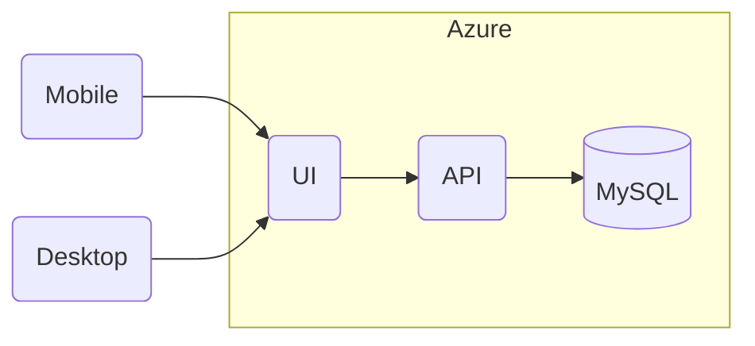
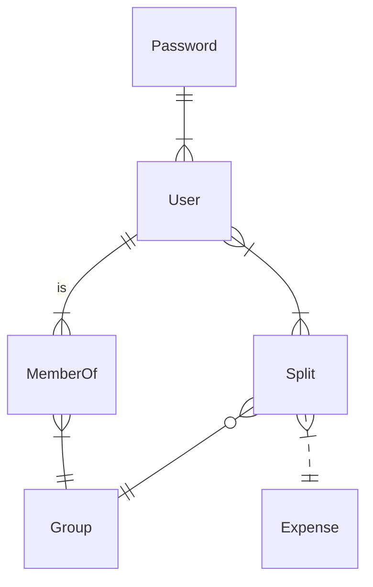

# ExpenseWise

A tool for tracking expenses and balances on a group level for varied occasions. ExpenseWise makes it easy to calculate totals by keeping an informal ledger that can be updated on an as needed basis.

## Project status and completion plan

Phase 1 is marked accepted in the delivery roadmap. The selected Phase 2 custom-amount feature is implemented on the current feature branch, with Docker-hosted acceptance verification still pending. Start with the [current-state assessment](docs/product/current-state.md), [product specification](docs/product/README.md), and [delivery roadmap](docs/product/roadmap.md).

Phase 1 targets local Docker Compose, registered participants, organizer-recorded USD expenses, equal splits among selected people, and manual repayment tracking. Phase 2 custom USD allocations are implemented on the current feature branch, with Docker-hosted acceptance verification pending. ExpenseWise does not process payments or target public hosting.

## Dependencies

- [MediatR](https://github.com/jbogard/MediatR/)
- [AutoMapper](https://docs.automapper.org/en/stable/Getting-started.html)
- [FluentValidation](https://docs.fluentvalidation.net/en/latest/)
- [Moq](https://github.com/devlooped/moq)
- [Entity Framework Core](https://learn.microsoft.com/en-us/ef/core/) with [MySQL Connector/NET](https://dev.mysql.com/doc/connector-net/en/connector-net-entityframework-core.html) (`MySql.EntityFrameworkCore`)
- [Docker](https://www.docker.com/support/)

## High Level Design

### Infrastructure



### Entity Relationship Diagram



## Developer Guide

A concise guide to get new developers up to speed with the codebase.

For the project documentation index, architecture decisions, and operating guidance, see [`docs/`](docs/README.md).

- **Quick Start:** Copy `.env.example` to `.env`, set a private local database password, then start the API, UI, database, and migration step:

```bash
cp -n .env.example .env
# Replace DB_PASSWORD and JWT_SIGNING_KEY in .env with private local values.
# Generate a signing key with: openssl rand -base64 48
docker compose up --build -d
docker compose logs -f
```

- **Prerequisites:**
   - .NET SDK 10.0 (for local development)
   - Docker Engine & Docker Compose
   - Optional: a MySQL client for inspecting the DB
   - Optional port overrides: `API_PORT`, `UI_PORT`, `FORWARD_DB_PORT`

- **Run Locally (without Docker):**
   - Set the required env vars, then run the Presentation projects:

```bash
dotnet build
cd src/Presentation/Api
Authentication__SigningKey='<private-random-value-of-at-least-32-bytes>' dotnet run
```

- **Rebuild Docker Images:**
   - Rebuild all images and recreate the running services:

```bash
docker compose up --build -d
```

   - To rebuild and recreate only one application service:

```bash
docker compose up --build -d webapi
docker compose up --build -d webapp
```

   - To rebuild images without starting or recreating containers, use `docker compose build` (optionally followed by a service name, such as `docker compose build webapi`).

- **Project Structure (high level):**
   - `src/Application/` — Use cases, request validators, MediatR handlers
   - `src/Configuration/` — Dependency-injection composition and service registration
   - `src/Core/` — Domain entities and value objects
   - `src/Infrastructure/` — Database adapters, EF Core, generated OpenAPI client
   - `src/Presentation/` — API and UI entrypoints and controllers
   - `src/Tests/` — Unit and integration tests

- **Architecture & Patterns:**
   - CQRS/MediatR for application flows
   - FluentValidation for request validation
   - EF Core with MySQL for data access
   - AutoMapper for mapping DTOs

- **Build & Test:**

```bash
dotnet build ExpenseWise.sln
dotnet test --no-build
```

- **Contributing:**
   - Use feature branches and open PRs against `main`/`develop` (project convention-dependent).
   - Run tests locally before submitting a PR.

- **Troubleshooting:**
   - In Docker Compose, the UI must reach the API at `http://webapi:8081/`. Do not use `localhost` for the API URL inside the UI container: that points back to the UI container itself. Compose configures this address automatically. To apply Compose configuration changes to a running UI container, recreate it with `docker compose up -d --force-recreate webapp`.
   - If migrations or DB issues occur, inspect the `src/Infrastructure/SqlDatabase/Migrations` folder and the container logs.
   - Use `docker compose logs <service>` to view specific service output.

- **References & Contacts:**
   - API startup: [src/Presentation/Api/Program.cs](src/Presentation/Api/Program.cs)
   - UI startup: [src/Presentation/UI/Program.cs](src/Presentation/UI/Program.cs)
   - Application entrypoints: [src/Application/UseCases/UseCases.csproj](src/Application/UseCases/UseCases.csproj)
