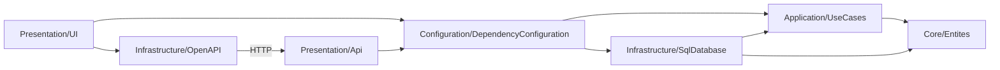

# Architecture

ExpenseWise is a .NET 10 solution organized around inward dependencies and separated presentation, application, domain, and infrastructure concerns.

`Configuration/DependencyConfiguration` is the composition layer that wires use cases and persistence adapters. The UI calls the API through the generated OpenAPI client; both application entry points register application use cases.

## Project responsibilities

| Project | Responsibility |
| --- | --- |
| `Core/Entites` | Domain entities and value objects; keep domain types independent of frameworks and infrastructure. |
| `Application/UseCases` | MediatR requests/handlers, validation, response wrappers, and repository ports. |
| `Infrastructure/SqlDatabase` | SQL persistence adapters, EF Core context/migrations, queries, and entity mappings. |
| `Infrastructure/OpenAPI` | Generated API client and its configuration. |
| `Configuration/DependencyConfiguration` | Dependency-injection composition and implementation bindings. |
| `Presentation/Api` | HTTP controllers, API contracts, and API startup. |
| `Presentation/UI` | MVC application, views, and API-client integration. |
| `Tests` | Regression/use-case and infrastructure test suites. |

## Change guidance

- Dependencies point inward: Core should not depend on Application, Infrastructure, or Presentation.
- Application declares ports; Infrastructure implements them. Wire implementations in the composition layer rather than from use cases.
- Keep controllers and views focused on presentation concerns. Put business decisions in use cases and domain concepts.
- Follow the existing request/response and validation conventions described in [ADR 0002](decisions/0002-mediatr-use-case-boundary.md).
- Check [the decision index](decisions/README.md) before changing an established architectural choice.

The diagram and responsibilities describe the current project structure; verify project references and registrations when working on architecture-sensitive changes.
