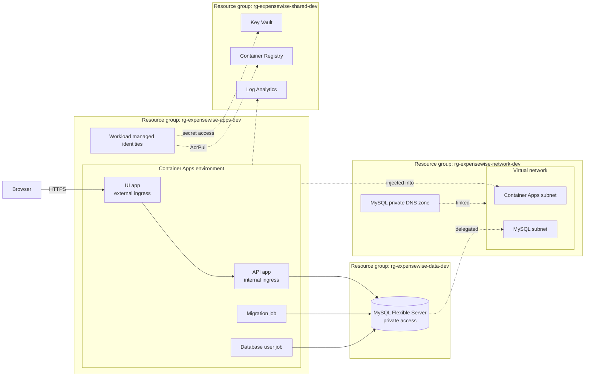

# Phase 3 specification: Azure demo deployment

Status: Accepted (package 3.0). Created and accepted: 2026-10-27.

This specification defines the first [Phase 3](roadmap.md#phase-3-optional-publicself-hosted-service) deliverable: one publicly reachable demonstration environment of ExpenseWise on Azure, provisioned with Terraform. It does not change product behavior defined in the [Phase 1 specification](README.md).

## Purpose and owner decisions

ExpenseWise is deployed as a portfolio demonstration, not as a service for real financial data. The project owner decided on 2026-10-27:

| Question | Decision |
| --- | --- |
| Environments | One `dev` environment. No `prod`. |
| Audience and domain | Public portfolio demo; use the Azure-generated hostname, no custom domain. |
| Database network | Private network access only. |
| Region and Terraform state | `westus3`; store state in a dedicated ExpenseWise resource group and storage account (see [ADR 0007](../architecture/decisions/0007-dedicated-expensewise-terraform-state.md)). |
| UI scale | One UI replica; no shared session or key store. |
| Sequencing | Accept this specification and its ADRs before any infrastructure or application change for Phase 3. |

On 2026-11-13, before any application resources were created in the new dedicated subscription, the owner split the single application resource group into network, data, shared, and apps groups and replaced the resource-group budget with a subscription budget (see [ADR 0008](../architecture/decisions/0008-resource-groups-by-lifecycle.md)).

The Phase 1 release gate is still open. Deploying before it closes is an owner decision; the demo inherits Phase 1's documented scope and known limitations.

## Target architecture

The hosting choice is recorded in [ADR 0005](../architecture/decisions/0005-azure-container-apps-hosting.md), and the resource-group layout in [ADR 0008](../architecture/decisions/0008-resource-groups-by-lifecycle.md).



| Component | Azure resource | Configuration |
| --- | --- | --- |
| Network | Virtual network with one subnet delegated to Container Apps and one delegated to MySQL Flexible Server | Private DNS zone for MySQL linked to the virtual network. No public IPs other than the UI ingress. |
| UI | Container App | External HTTPS ingress, insecure HTTP disabled. Exactly one replica (minimum and maximum 1). Receives no database settings or secrets. |
| API | Container App | Internal ingress only, reachable from apps in the same environment. Exactly one replica (minimum and maximum 1) to bound cost. |
| Migrations | Container Apps manual job | Runs the API image with `--migrate` using the MySQL administrator credentials. Parallelism and replica completion count 1. |
| Database user | Container Apps manual job | Runs a pinned MySQL 8.0 client image with a committed, idempotent SQL script that creates or updates the application user, its password, and its grants. Parallelism 1. |
| Database | Azure Database for MySQL Flexible Server, Burstable B1ms, MySQL 8.0 | Private access only, TLS required, `utf8mb4` and `utf8mb4_unicode_ci`, 20 GiB storage, 7-day locally redundant backups, no high availability. Terraform creates the ExpenseWise database through the Azure control plane. |
| Images | Azure Container Registry, Basic | Administrator user disabled; workloads pull with managed identities (`AcrPull`). The MySQL client image is imported into the registry and referenced by digest. |
| Secrets | Azure Key Vault | Azure RBAC authorization with role assignments scoped to individual secrets (see [workload identities](#workload-identities)). Purge protection off so the dev environment can be destroyed and recreated. |
| Logs | Log Analytics workspace | Container console and system logs, 30-day retention. |
| Cost alerting | Subscription budget | Monthly budget for the dedicated subscription with email alerts at 80% and 100% of actual cost. Budgets only notify, after a cost-data delay of hours or more; they never stop resources. |

| Resource group | Contents |
| --- | --- |
| `rg-expensewise-network-dev` | Virtual network, delegated subnets, MySQL private DNS zone and link |
| `rg-expensewise-data-dev` | MySQL Flexible Server and the ExpenseWise database |
| `rg-expensewise-shared-dev` | Container Registry, Key Vault and secrets, Log Analytics workspace |
| `rg-expensewise-apps-dev` | Container Apps environment, apps, manual jobs, and workload managed identities |

Terraform state remains in the separate `rg-expensewise-tfstate` group ([ADR 0007](../architecture/decisions/0007-dedicated-expensewise-terraform-state.md)), created by the `infra/bootstrap` root ([ADR 0009](../architecture/decisions/0009-terraform-bootstrap-and-environment-roots.md)). Azure creates and manages the Container Apps infrastructure group `me_expensewise_dev`.

Resource names follow `<type>-expensewise-dev`, and resource groups follow `rg-expensewise-<category>-dev`. Globally unique names (registry, Key Vault, and MySQL server) include a short random suffix. The registry is an exception: use `acrexpensewisedev<suffix>` with an alphanumeric suffix because Azure Container Registry names allow only alphanumeric characters. Every taggable resource managed by Terraform or the state bootstrap carries `application`, `environment`, `managed_by`, and `owner` tags. The owner is `Luis Teran`, configured in `infra/azure/environments/dev.tfvars` and `infra/bootstrap`. Azure-managed infrastructure and resource types that do not support tags are excluded.

The Container Apps environment and Terraform state storage are dedicated to ExpenseWise. Existing resources of other projects in the subscription are not modified or reused.

## Configuration and secrets

| Setting | Consumer | Source |
| --- | --- | --- |
| `Database__Host`, `Database__Port`, `Database__Name` | API, migration job | Terraform outputs (non-secret) |
| `Database__Username`, `Database__Password` | API | Application user; password in Key Vault |
| `Database__Username`, `Database__Password` | Migration job | MySQL administrator; password in Key Vault |
| Administrator and application user credentials, database host and name | Database user job | Key Vault (passwords) and Terraform outputs |
| `Authentication__SigningKey` | API | Key Vault |
| `ExpenseWiseApi__BaseUrl` | UI | The API app's internal address |

- Terraform generates the MySQL administrator password, application user password, and JWT signing key with the `random` provider and stores them in Key Vault. Container Apps reference them as Key Vault-backed secrets and inject the values into the container's environment variables at runtime. Secret values are never committed, built into images, written in workflow files, or stored directly in Container Apps configuration.
- Generated secrets are also present in Terraform state. Access to the state container is therefore restricted as strictly as access to Key Vault.
- The application user receives only `SELECT`, `INSERT`, `UPDATE`, and `DELETE` on the ExpenseWise database. Schema changes use the administrator account only inside the migration job.
- Values that identify the subscription, tenant, state storage account, budget contact, or deployed hostname are supplied through uncommitted files or pipeline variables, never committed. See [Security](../security/README.md).

### Workload identities

Each workload has its own user-assigned managed identity, so a compromise of the public UI does not expose database or token secrets.

| Identity | Registry | Key Vault secrets it can read |
| --- | --- | --- |
| UI | `AcrPull` | None |
| API | `AcrPull` | Application user password, signing key |
| Migration job | `AcrPull` | Administrator password |
| Database user job | `AcrPull` | Administrator password, application user password |

Owner on the subscription grants no Key Vault data access. Terraform therefore gives the identity that runs it `Key Vault Secrets Officer` on the vault so that it can write the generated secrets. Workloads only read secrets.

Anyone allowed to start or change the migration or database user jobs can run a different image or command with administrator credentials. The deployment identity in package 3.3 is therefore treated as a database-administrator trust boundary: its role is scoped to the ExpenseWise apps resource group and the registry, and releases run in a protected GitHub environment that only `master` can use.

## Application readiness requirements

These changes must be made and tested in package 3.1, without breaking the local Compose workflow:

1. **Environment:** images no longer hard-code `ASPNETCORE_ENVIRONMENT=Development`. They default to Production; Compose sets Development explicitly so local OpenAPI and Swagger behavior is preserved. In Azure, the API does not serve OpenAPI or Swagger UI.
2. **Reverse proxy and cookies:** the UI honors `X-Forwarded-Proto` from the Container Apps ingress so HTTPS redirection and HSTS behave correctly, and its authentication and session cookies are marked `Secure` outside Development.
3. **Health:** the API exposes an anonymous liveness endpoint and a readiness endpoint that checks database connectivity. The UI exposes an anonymous liveness endpoint. Container Apps probes use them. The existing API `GET /Health` response is preserved unless a change is explicitly documented.
4. **Database TLS:** the database connection's SSL mode is configurable through the composition layer, keeps current local behavior by default, and is set to require TLS in Azure. The repository uses Oracle's `MySql.EntityFrameworkCore` and `MySql.Data` provider, so the setting must be implemented and tested against `MySql.Data.MySqlClient.MySqlConnectionStringBuilder`. Certificate verification (`VerifyFull`) is preferred if it is verified to work against Flexible Server.
5. **Container hardening:** runtime images run as the non-root `app` user provided by the .NET base images.
6. **Known sign-out behavior:** the UI's in-memory session and data-protection keys remain. Every UI restart or new revision signs users out. This is accepted for the demo and documented.

## Delivery

### Infrastructure as code

The Terraform choice and state handling are recorded in [ADR 0006](../architecture/decisions/0006-terraform-infrastructure-as-code.md), its replacement [ADR 0007](../architecture/decisions/0007-dedicated-expensewise-terraform-state.md), and the layout in [ADR 0009](../architecture/decisions/0009-terraform-bootstrap-and-environment-roots.md), and the first-deployment rollout in [ADR 0010](../architecture/decisions/0010-commit-sha-image-rollout.md). Terraform has two roots:

- [`infra/bootstrap`](../../infra/bootstrap) creates the dedicated state resource group, storage account, `tfstate-<environment>` containers, and delete lock. It keeps its own state locally; that file is ignored by Git, and the owner keeps a private copy.
- [`infra/azure`](../../infra/azure) is the environment, one root split into files by concern. Committed per-environment inputs live in `environments/<environment>.tfvars` and `environments/<environment>.backend.hcl`. The storage account name is supplied at `init`, the subscription comes from `ARM_SUBSCRIPTION_ID`, and private inputs go in the ignored `local.auto.tfvars`. Release scripts are in `scripts/`, and the database user job image is in `mysql-client/`.

Both roots pin exact provider versions, commit their dependency lock files, and run on the latest Terraform CLI. The root [`Makefile`](../../Makefile) wraps the workflow: `make tf-check` runs formatting, validation, mock-provider tests from `infra/azure/tests`, and a Checkov scan without Azure credentials, and the CI `infrastructure` job runs it for every pull request and push to `master`. Accepted trade-offs are recorded as justified `#checkov:skip` comments. Set `TERRAFORM=<path>` to use a binary other than the `terraform` on `PATH`.

Terraform owns the infrastructure, including the Container Apps and jobs, but ignores the container image of each app and job. The release process owns images so that deployments do not fight Terraform.

Bootstrapping the first apply must account for four constraints:

- The bootstrap storage account disables shared-key access and uses Entra ID for Blob operations. Its container-scoped data role cannot be granted until the container exists, so first create the account, temporarily grant the owner account-scoped Blob access, and remove that grant after the container role propagates.
- Container Apps and jobs need a pullable image when they are created. Terraform creates every app and job from the registry images tagged with `image_tag`, a full Git commit SHA (never `latest`). Those images must therefore be built before the apps and jobs are created.
- The API readiness probe checks the database as the application user, which exists only after the database user job has run. The API is therefore created only after the database user and migration jobs succeed.
- Azure role assignments propagate eventually, and Terraform's dependency ordering does not wait for them. Terraform waits 60 seconds after granting itself Key Vault access before writing secrets, and 60 seconds after the workload role assignments before creating any app or job. If a create still fails with an authorization error, wait a few minutes, then plan and apply again.

### Manual first deployment

The first deployment uses targeted plans so that each step has what it needs. Run every step from the same clean commit. `IMAGE_TAG` defaults to the checked-out commit and selects the images that Terraform creates the apps and jobs with.

1. Sign in with the owner identity, select the intended subscription, and export it as `ARM_SUBSCRIPTION_ID`. For a new subscription, register the Container Apps resource provider with `az provider register --namespace Microsoft.App --wait`; it is not included in the pinned AzureRM provider's default registration set. Pass `TERRAFORM=<path>` to every `make` command only when you want a binary other than the `terraform` on `PATH`; the release script uses the same binary.
2. Run `terraform -chdir=infra/bootstrap init`. The storage account must exist before its containers can be created: with Entra ID data-plane authorization enabled, the bootstrap identity does not yet have Blob permissions, and the container-scoped role assignment cannot be created until its container exists. First create only the account and its prerequisites with `terraform -chdir=infra/bootstrap plan -target=azurerm_storage_account.state -out=bootstrap-storage.tfplan`; review and apply it with `terraform -chdir=infra/bootstrap apply bootstrap-storage.tfplan`.
3. Temporarily grant the signed-in owner identity `Storage Blob Data Contributor` on the storage account so Terraform can create the containers. Capture the assignment ID to remove this broader grant after the container-scoped assignment is active:
   ```sh
   set -e
   STORAGE_ACCOUNT_NAME=$(terraform -chdir=infra/bootstrap output -raw storage_account_name)
   STATE_ACCOUNT_ID=$(az storage account show --name "$STORAGE_ACCOUNT_NAME" --resource-group rg-expensewise-tfstate --query id -o tsv)
   OWNER_OBJECT_ID=$(az ad signed-in-user show --query id -o tsv)
   TEMP_ROLE_ASSIGNMENT_ID=$(az role assignment create \
     --assignee-object-id "$OWNER_OBJECT_ID" \
     --assignee-principal-type User \
     --role "Storage Blob Data Contributor" \
     --scope "$STATE_ACCOUNT_ID" \
     --query id -o tsv)
   ```
   Allow a minute for the role assignment to propagate. Then run the normal `terraform -chdir=infra/bootstrap plan -out=bootstrap.tfplan`, review it, and apply it with `terraform -chdir=infra/bootstrap apply bootstrap.tfplan`. Record the `storage_account_name` output, allow the container-scoped role assignment to propagate, and remove the temporary account-scoped grant with `az role assignment delete --ids "$TEMP_ROLE_ASSIGNMENT_ID"`. Back up `infra/bootstrap/terraform.tfstate` privately.
4. Create ignored `infra/azure/local.auto.tfvars` containing the private budget-alert recipient, for example `budget_contact_email = "owner@example.com"`. Do not commit this file or put real account identifiers in tracked configuration.
5. Commit the changes to be deployed so that the working tree is clean, then run `make tf-init TF_STATE_ACCOUNT=<storage_account_name>`.
6. Create the budget and registry with `make tf-plan TF_TARGETS="azurerm_consumption_budget_subscription.monthly azurerm_container_registry.expensewise"`. Inspect the saved plan with `terraform -chdir=infra/azure show dev.tfplan`. Only the owner applies a plan, with `make tf-apply`, after reviewing it. Terraform warns that resource targeting is in effect; this is expected here and in step 8.
7. Run `make azure-images`. It imports the pinned MySQL client base image, then builds the API, UI, and MySQL client images in the registry, tagged with the commit SHA.
8. Create the jobs and their dependencies with `make tf-plan TF_TARGETS="azurerm_container_app_job.database_user azurerm_container_app_job.migration"`, review the plan, and apply it with `make tf-apply`. This creates the network, database, vault and secrets, identities and role assignments, Container Apps environment, and both jobs, but not the apps.
9. Run `make azure-database-jobs`. It runs the database user job, then the migration job, and stops if either fails.
10. Run `make tf-plan` without targets, review the plan, and apply it. This creates the API and UI from the same images; the API becomes ready because the application user and schema now exist. Confirm that the next `make tf-plan` shows no changes. The deployment exit gate still requires the live network/HTTPS checks and the browser scenario and persistence checks in the package acceptance criteria.

For later releases, commit and run `make azure-release`. It runs [`release.sh`](../../infra/azure/scripts/release.sh) for the checked-out commit: it builds the images, runs the database user job and then the migration job, and updates the API before the UI. Any failed job stops before either app is changed. Terraform ignores the images of the apps and jobs, so a plan after a release stays empty.

Plan files contain Terraform's sensitive values and are ignored by Git. Keep them private and remove them when they are no longer needed. No infrastructure is provisioned merely by running `terraform init`, `fmt`, `validate`, `test`, or `make tf-check`.

If both the application resources and their state backend were deleted, recreate the backend with `infra/bootstrap` and use `make tf-init`, which reconfigures the backend; do not migrate the old state or reuse saved plans. The monthly budget starts on the first day of the month in which it is first applied, recorded by a `time_static` resource, so no budget dates need editing.

### Release sequence

A single scripted release procedure is used both manually (package 3.2) and from GitHub Actions (package 3.3):

1. Build the API and UI images and push them to the registry tagged with the full commit SHA. Never deploy `latest`.
2. Run the database user job, then the migration job with the new API image. Stop the release if either fails.
3. Update the API app, wait for its revision to become healthy, then update the UI app.
4. Run the Azure verification described below.

Migrations run while the previous API revision still serves traffic, and they are not reversed automatically. A release can therefore cause brief errors, which is acceptable for the demo. Redeploying the previous commit SHA's images is a valid rollback only when the new schema remains compatible with the previous image. A migration that is incompatible with the previous image, or cannot run against existing data, needs its own reviewed plan, which may rely on a point-in-time restore instead of an image rollback.

### Verification in Azure

The API has no public ingress, so acceptance tests that call the API directly (currently the anonymous request check in the access-boundary test) cannot run against Azure from outside the environment. Package 3.3 separates those checks so the browser-only scenarios can run against Azure, while the direct API checks continue to run against Compose in CI.

## Packages

| Package | Depends on | Deliverable | Exit gate |
| --- | --- | --- | --- |
| 3.0 Specification and ADRs | None | This specification, ADRs 0005 and 0006, and roadmap updates. | The owner accepts the specification and ADRs, and their status changes to Accepted. |
| 3.1 Application readiness | 3.0 | The [application readiness requirements](#application-readiness-requirements), with tests and updated documentation. | Build and all tests pass; the Compose stack and its acceptance tests pass unchanged; a Production-mode API image does not serve OpenAPI; containers run as non-root; health endpoints respond as specified. |
| 3.2 Terraform foundation and first release | 3.1 | Terraform for every resource in the [target architecture](#target-architecture), the state bootstrap root, credential-free Terraform checks in CI, the release script, and a manual first release. | `make tf-check` passes (formatting, validation, mock-provider tests, and Checkov); the owner reviews the plan before apply; a second plan shows no changes; MySQL public network access is disabled; the API is unreachable from the internet; HTTP to the UI does not serve content without HTTPS; scenario A completes in a browser on Azure; after the apps restart, signing in again shows the same ledger. |
| 3.3 Deployment pipeline | 3.2 | A GitHub Actions workflow that authenticates to Azure with OpenID Connect and runs the release sequence for a `master` commit after CI passes. Terraform pull-request checks already run in the CI `infrastructure` job from package 3.2. | No long-lived Azure credential is stored in GitHub; a release deploys a specific commit SHA; a failing migration stops the release before the apps change; rerunning a release is safe; browser verification runs against Azure. |
| 3.4 Azure operations guide | 3.2 | Operations documentation for the Azure environment. | A point-in-time restore to a separate, disposable server is rehearsed and reconciled; log queries, alerts, budget, stopping and starting the database to save cost, secret rotation, and `terraform destroy` teardown are documented and checked. |

Only the owner applies Terraform. The pipeline identity in package 3.3 may build and push images to the registry and update Container Apps and jobs in the apps resource group; it does not create role assignments or change other infrastructure.

## Estimated cost

An unverified estimate of approximately USD 25–40 per month at pay-as-you-go `westus3` prices, dominated by the MySQL server, Container Registry Basic, and the two always-on replicas. The Container Apps monthly free grant is shared with other workloads in the subscription and is not assumed. Fixed replica counts bound compute cost, but log ingestion grows with traffic. Package 3.2 confirms the estimate with the Azure pricing calculator.

Stopping the MySQL server when the demo is not needed saves compute cost, but storage and backups are still billed and Azure starts a stopped server automatically after 30 days.

## Accepted risks and limitations

- **Public registration and sign-in.** Anyone can create an account. There is no rate limiting, account lockout, email verification, or password recovery. Demo data may be deleted at any time and must not contain real personal or financial information.
- **Single replicas.** UI restarts and deployments sign users out; there is no zero-downtime deployment. Heavy public traffic is throttled by capacity rather than absorbed by scaling.
- **Costs alert, not cap.** The budget notifies after a delay; nothing stops spending automatically.
- **Public data-plane endpoints.** Key Vault and Container Registry keep public endpoints protected by Microsoft Entra ID and Azure RBAC. Private endpoints and the Premium registry tier cost more than this demo justifies.
- **Secrets in Terraform state.** Generated secrets are stored in state; see [ADR 0006](../architecture/decisions/0006-terraform-infrastructure-as-code.md).
- **Local bootstrap state.** The `infra/bootstrap` state is kept on the owner's machine, not in the backend it creates. If it is lost, the state storage resources must be imported before that root can change them; see [ADR 0009](../architecture/decisions/0009-terraform-bootstrap-and-environment-roots.md).
- **No subnet network security groups.** Exposure is controlled by Container Apps ingress (internal API, HTTPS-only UI) and by MySQL's private VNet integration with public access disabled. Subnet NSGs are not configured.
- **Observability.** Only console logs and the cost budget are in scope. Application Insights, metric alerts, and uptime tests are deferred.
- **Not production.** This environment does not satisfy the Phase 3 public-service requirements for account recovery, data retention, incident response, or a formal security review.

## Out of scope

A production environment, custom domains, Azure Front Door or a web application firewall, multiple UI replicas, Redis or Blob-backed session and key storage, Microsoft Entra authentication for MySQL, geo-redundant backups or high availability, and multi-region deployment.
