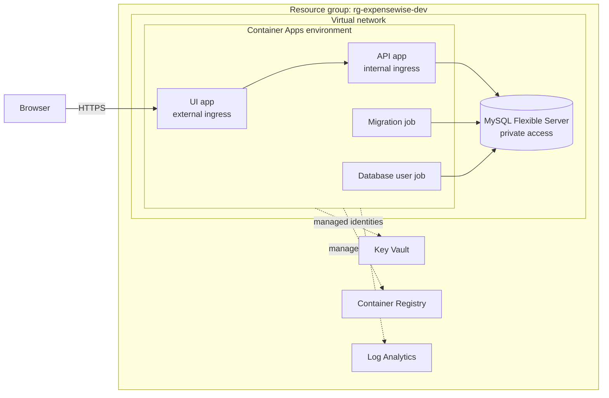

# Phase 3 specification: Azure demo deployment

Status: Accepted (package 3.0). Created and accepted: 2026-10-27.

This specification defines the first [Phase 3](roadmap.md#phase-3-optional-publicself-hosted-service) deliverable: one publicly reachable demonstration environment of ExpenseWise on Azure, provisioned with Terraform. It does not change product behavior defined in the [Phase 1 specification](README.md).

## Purpose and owner decisions

ExpenseWise is deployed as a portfolio demonstration, not as a service for real financial data. The project owner decided on 2026-10-27:

| Question | Decision |
| --- | --- |
| Environments | One `dev` environment. No `prod`. |
| Audience and domain | Public portfolio demo; use the Azure-generated hostname, no custom domain. |
| Database network | Private network access only. |
| Region and Terraform state | `westus3`; store state in a new container in an existing storage account shared with another of the owner's projects (see [ADR 0006](../architecture/decisions/0006-terraform-infrastructure-as-code.md)). |
| UI scale | One UI replica; no shared session or key store. |
| Sequencing | Accept this specification and its ADRs before any infrastructure or application change for Phase 3. |

The Phase 1 release gate is still open. Deploying before it closes is an owner decision; the demo inherits Phase 1's documented scope and known limitations.

## Target architecture

The hosting choice is recorded in [ADR 0005](../architecture/decisions/0005-azure-container-apps-hosting.md).

| Component | Azure resource | Configuration |
| --- | --- | --- |
| Network | Virtual network with one subnet delegated to Container Apps and one delegated to MySQL Flexible Server | Private DNS zone for MySQL linked to the virtual network. No public IPs other than the UI ingress. |
| UI | Container App | External HTTPS ingress, insecure HTTP disabled. Exactly one replica (minimum and maximum 1). Receives no database settings or secrets. |
| API | Container App | Internal ingress only, reachable from apps in the same environment. Exactly one replica (minimum and maximum 1) to bound cost. |
| Migrations | Container Apps manual job | Runs the API image with `--migrate` using the MySQL administrator credentials. Parallelism and replica completion count 1. |
| Database user | Container Apps manual job | Runs a pinned MySQL 8.0 client image with a committed, idempotent SQL script that creates or updates the application user, its password, and its grants. Parallelism 1. |
| Database | Azure Database for MySQL Flexible Server, Burstable B1ms, MySQL 8.0 | Private access only, TLS required, `utf8mb4` and `utf8mb4_unicode_ci`, 20 GiB storage, 7-day locally redundant backups, no high availability. Terraform creates the ExpenseWise database through the Azure control plane. |
| Images | Azure Container Registry, Basic | Administrator user disabled; workloads pull with managed identities (`AcrPull`). The MySQL client image is imported into the registry and referenced by digest. |
| Secrets | Azure Key Vault | Azure RBAC authorization with role assignments scoped to individual secrets (see [workload identities](#workload-identities)). Purge protection off so the dev environment can be destroyed and recreated. |
| Logs | Log Analytics workspace | Container console and system logs, 30-day retention. |
| Cost alerting | Resource group budget | Monthly budget with email alerts at 80% and 100% of actual cost. Budgets only notify, after a cost-data delay of hours or more; they never stop resources. |

Resource names follow `<type>-expensewise-dev`, with a short random suffix for globally unique names (registry, Key Vault, and MySQL server). Every resource carries `application`, `environment`, `managed_by`, and `owner` tags.

The Container Apps environment is new and dedicated to ExpenseWise. Existing resources of other projects in the subscription are not modified or reused, except for the Terraform state container described in [ADR 0006](../architecture/decisions/0006-terraform-infrastructure-as-code.md).

## Configuration and secrets

| Setting | Consumer | Source |
| --- | --- | --- |
| `Database__Host`, `Database__Port`, `Database__Name` | API, migration job | Terraform outputs (non-secret) |
| `Database__Username`, `Database__Password` | API | Application user; password in Key Vault |
| `Database__Username`, `Database__Password` | Migration job | MySQL administrator; password in Key Vault |
| Administrator and application user credentials, database host and name | Database user job | Key Vault (passwords) and Terraform outputs |
| `Authentication__SigningKey` | API | Key Vault |
| `ExpenseWiseApi__BaseUrl` | UI | The API app's internal address |

- Terraform generates the MySQL administrator password, application user password, and JWT signing key with the `random` provider and stores them in Key Vault. Container Apps reference them as Key Vault-backed secrets and inject the values into the container's environment variables at runtime. Secret values are never committed, built into images, written in workflow files, or stored directly in Container Apps configuration.
- Generated secrets are also present in Terraform state. Access to the state container is therefore restricted as strictly as access to Key Vault.
- The application user receives only `SELECT`, `INSERT`, `UPDATE`, and `DELETE` on the ExpenseWise database. Schema changes use the administrator account only inside the migration job.
- Values that identify the subscription, tenant, state storage account, budget contact, or deployed hostname are supplied through uncommitted files or pipeline variables, never committed. See [Security](../security/README.md).

### Workload identities

Each workload has its own user-assigned managed identity, so a compromise of the public UI does not expose database or token secrets.

| Identity | Registry | Key Vault secrets it can read |
| --- | --- | --- |
| UI | `AcrPull` | None |
| API | `AcrPull` | Application user password, signing key |
| Migration job | `AcrPull` | Administrator password |
| Database user job | `AcrPull` | Administrator password, application user password |

Anyone allowed to start or change the migration or database user jobs can run a different image or command with administrator credentials. The deployment identity in package 3.3 is therefore treated as a database-administrator trust boundary: its role is scoped to the ExpenseWise resource group, and releases run in a protected GitHub environment that only `master` can use.

## Application readiness requirements

These changes must be made and tested in package 3.1, without breaking the local Compose workflow:

1. **Environment:** images no longer hard-code `ASPNETCORE_ENVIRONMENT=Development`. They default to Production; Compose sets Development explicitly so local OpenAPI and Swagger behavior is preserved. In Azure, the API does not serve OpenAPI or Swagger UI.
2. **Reverse proxy and cookies:** the UI honors `X-Forwarded-Proto` from the Container Apps ingress so HTTPS redirection and HSTS behave correctly, and its authentication and session cookies are marked `Secure` outside Development.
3. **Health:** the API exposes an anonymous liveness endpoint and a readiness endpoint that checks database connectivity. The UI exposes an anonymous liveness endpoint. Container Apps probes use them. The existing API `GET /Health` response is preserved unless a change is explicitly documented.
4. **Database TLS:** the database connection's SSL mode is configurable through the composition layer, keeps current local behavior by default, and is set to require TLS in Azure. The repository uses Oracle's `MySql.EntityFrameworkCore` and `MySql.Data` provider, so the setting must be implemented and tested against `MySql.Data.MySqlClient.MySqlConnectionStringBuilder`. Certificate verification (`VerifyFull`) is preferred if it is verified to work against Flexible Server.
5. **Container hardening:** runtime images run as the non-root `app` user provided by the .NET base images.
6. **Known sign-out behavior:** the UI's in-memory session and data-protection keys remain. Every UI restart or new revision signs users out. This is accepted for the demo and documented.

## Delivery

### Infrastructure as code

The Terraform choice and state handling are recorded in [ADR 0006](../architecture/decisions/0006-terraform-infrastructure-as-code.md). Terraform lives in `infra/terraform` as one root module split into files by concern. It pins Terraform and provider versions and commits the dependency lock file. Non-secret dev values are committed in `dev.tfvars`; backend settings are supplied from an uncommitted `backend.hcl`.

Terraform owns the infrastructure, including the Container Apps and jobs, but ignores the container image of each app and job. The release process owns images so that deployments do not fight Terraform.

Bootstrapping the first apply must account for two constraints:

- Container Apps and jobs need a valid image when they are created. Terraform creates every app and job with a public placeholder image pinned by digest, and its health probes must not block the placeholder from starting. The first release replaces the placeholders.
- Azure role assignments propagate eventually, and Terraform's dependency ordering does not wait for them. Identities, Key Vault, secrets, and role assignments are created first; workloads that reference Key Vault secrets or the registry are created only after access has been confirmed, using a bounded wait or retry. A first-release registry pull that fails for authorization reasons must fail clearly rather than loop.

### Release sequence

A single scripted release procedure is used both manually (package 3.2) and from GitHub Actions (package 3.3):

1. Build the API and UI images and push them to the registry tagged with the full commit SHA. Never deploy `latest`.
2. Run the database user job, then the migration job with the new API image. Stop the release if either fails.
3. Update the API app, wait for its revision to become healthy, then update the UI app.
4. Run the Azure verification described below.

Migrations run while the previous API revision still serves traffic, and they are not reversed automatically. A release can therefore cause brief errors, which is acceptable for the demo. Redeploying the previous commit SHA's images is a valid rollback only when the new schema remains compatible with the previous image. A migration that is incompatible with the previous image, or cannot run against existing data, needs its own reviewed plan, which may rely on a point-in-time restore instead of an image rollback.

### Verification in Azure

The API has no public ingress, so acceptance tests that call the API directly (currently the anonymous request check in the access-boundary test) cannot run against Azure from outside the environment. Package 3.3 separates those checks so the browser-only scenarios can run against Azure, while the direct API checks continue to run against Compose in CI.

## Packages

| Package | Depends on | Deliverable | Exit gate |
| --- | --- | --- | --- |
| 3.0 Specification and ADRs | None | This specification, ADRs 0005 and 0006, and roadmap updates. | The owner accepts the specification and ADRs, and their status changes to Accepted. |
| 3.1 Application readiness | 3.0 | The [application readiness requirements](#application-readiness-requirements), with tests and updated documentation. | Build and all tests pass; the Compose stack and its acceptance tests pass unchanged; a Production-mode API image does not serve OpenAPI; containers run as non-root; health endpoints respond as specified. |
| 3.2 Terraform foundation and first release | 3.1 | Terraform for every resource in the [target architecture](#target-architecture), the state container, the release script, and a manual first release. | `terraform fmt -check` and `terraform validate` pass; the owner reviews the plan before apply; a second plan shows no changes; MySQL public network access is disabled; the API is unreachable from the internet; HTTP to the UI does not serve content without HTTPS; scenario A completes in a browser on Azure; after the apps restart, signing in again shows the same ledger. |
| 3.3 Deployment pipeline | 3.2 | A GitHub Actions workflow that authenticates to Azure with OpenID Connect and runs the release sequence for a `master` commit after CI passes, plus PR checks for `terraform fmt` and `validate`. | No long-lived Azure credential is stored in GitHub; a release deploys a specific commit SHA; a failing migration stops the release before the apps change; rerunning a release is safe; browser verification runs against Azure. |
| 3.4 Azure operations guide | 3.2 | Operations documentation for the Azure environment. | A point-in-time restore to a separate, disposable server is rehearsed and reconciled; log queries, alerts, budget, stopping and starting the database to save cost, secret rotation, and `terraform destroy` teardown are documented and checked. |

Only the owner applies Terraform. The pipeline identity in package 3.3 may push images and update Container Apps and jobs in the ExpenseWise resource group; it does not create role assignments or change other infrastructure.

## Estimated cost

An unverified estimate of approximately USD 25–40 per month at pay-as-you-go `westus3` prices, dominated by the MySQL server, Container Registry Basic, and the two always-on replicas. The Container Apps monthly free grant is shared with other workloads in the subscription and is not assumed. Fixed replica counts bound compute cost, but log ingestion grows with traffic. Package 3.2 confirms the estimate with the Azure pricing calculator.

Stopping the MySQL server when the demo is not needed saves compute cost, but storage and backups are still billed and Azure starts a stopped server automatically after 30 days.

## Accepted risks and limitations

- **Public registration and sign-in.** Anyone can create an account. There is no rate limiting, account lockout, email verification, or password recovery. Demo data may be deleted at any time and must not contain real personal or financial information.
- **Single replicas.** UI restarts and deployments sign users out; there is no zero-downtime deployment. Heavy public traffic is throttled by capacity rather than absorbed by scaling.
- **Costs alert, not cap.** The budget notifies after a delay; nothing stops spending automatically.
- **Public data-plane endpoints.** Key Vault and Container Registry keep public endpoints protected by Microsoft Entra ID and Azure RBAC. Private endpoints and the Premium registry tier cost more than this demo justifies.
- **Secrets in Terraform state.** Generated secrets are stored in state; see [ADR 0006](../architecture/decisions/0006-terraform-infrastructure-as-code.md).
- **Shared state storage.** The state storage account is owned and managed by another project; see [ADR 0006](../architecture/decisions/0006-terraform-infrastructure-as-code.md).
- **Observability.** Only console logs and the cost budget are in scope. Application Insights, metric alerts, and uptime tests are deferred.
- **Not production.** This environment does not satisfy the Phase 3 public-service requirements for account recovery, data retention, incident response, or a formal security review.

## Out of scope

A production environment, custom domains, Azure Front Door or a web application firewall, multiple UI replicas, Redis or Blob-backed session and key storage, Microsoft Entra authentication for MySQL, geo-redundant backups or high availability, and multi-region deployment.
